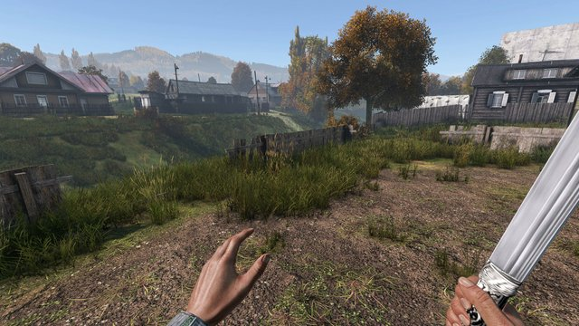
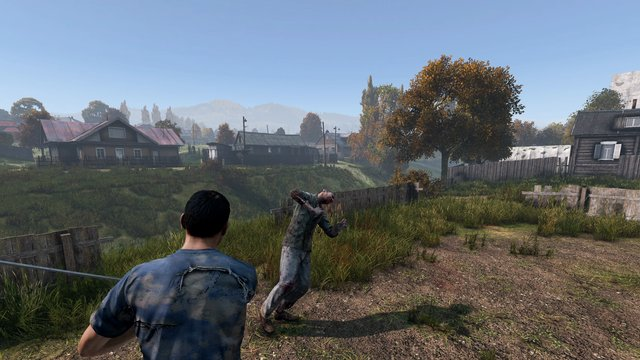
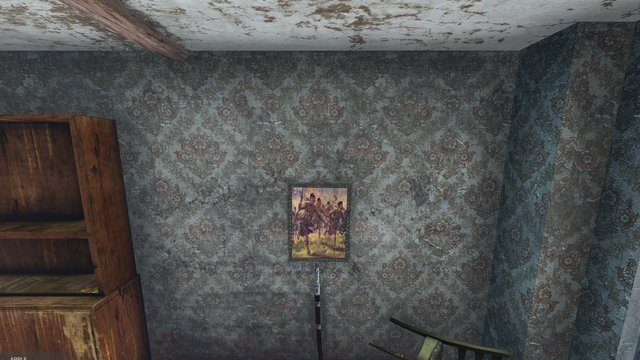
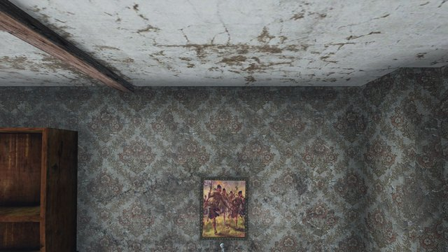

# Shashka

 [Built by Claude Code with the `universal-modder` plugin](https://github.com/rehan-remade/universal-modder)

[](https://github.com/rehan-remade/universal-modder)

**English** · [Русский](README-RU.md) · [Español](README-ES.md) · [Português](README-PT.md)

**[Steam Workshop](https://steamcommunity.com/sharedfiles/filedetails/?id=3818636663)** · **[Video (YouTube)](https://youtu.be/jrHFKSWTluk)**

<table>
<tr><td align="center"><a href="docs/screenshots/01_blade.jpg"></a><br><sub>In hand</sub></td><td align="center"><a href="docs/screenshots/02_cut.jpg"></a><br><sub>One cut</sub></td></tr>
<tr><td align="center"><a href="docs/screenshots/03_painting.jpg"></a><br><sub>Under the painting</sub></td><td align="center"><a href="docs/screenshots/04_painting_wide.jpg"></a><br><sub>Where to find it</sub></td></tr>
</table>

A DayZ mod: a Caucasian-style shashka (silver and niello mounts, three fullers) that kills anything in one cut,
wears out with the kills it makes and is sharpened back on a whetstone, and its leather sheath, worn on the belt's
left side. Sheaths with the blade in them stand under the painting of charging soldiers in village houses.

Client + server mod `@Shashka`. Its own models, textures and damage materials; the animations and hands are the
Machete's.

## What it does

- **The cut:** a light or heavy hit kills players, infected and animals (how many hits is configurable: each takes
  1/N of the target's full health on top of the blade's own damage). The kill is credited to the attacker.
- **Reach:** longer than the Machete's; the server sends its numbers to every client on connect.
- **Wear by kills:** swinging doesn't blunt it, killing does - damaged after N kills, badly damaged after N × 1.7,
  ruined after N × 3 (the count is saved with the item). How hard it cuts in each state is configurable; by default a ruined blade does only the Machete's damage.
- **Whetstone:** the vanilla "Sharpen" recipe takes it up one level (badly damaged → damaged → pristine) and uses a
  set share of the stone. A ruined blade can't be sharpened.
- **Sheath:** `SK_Sheath` hangs on a belt's left side (`Belt_Left`), goes on the back (shoulder slot) or a backpack's strap (not a canvas, courier or sling bag's), and holds the blade, hilt showing. Of the
  vanilla belts the military belt shows it; the leather belt doesn't render that slot at all.
- **Other slots:** the bare blade on the back (melee / shoulder) or a backpack's strap, hilt up - each off by default.
- **Spawns:** sheaths with the blade in them, standing under the painting of charging soldiers in village houses,
  placed and topped up by the mod itself.
- **Translations:** all thirteen DayZ languages.

## Contents

- `mod/Shashka` - the addon: config, scripts, models (MLOD `.p3d`), textures (`.paa`), materials (`.rvmat`) and the
  stringtable. Pack it into a pbo with the prefix `Shashka` using the tool you prefer, and sign it with your key.
- `mod/mod.cpp` - the mod's name and author, for the `@Shashka` folder.
- `mod/shashka.json` - the server settings with their defaults.
- `missions/<map>/shashka` - the spawn spots for the vanilla maps: Chernarus (358 spots), Livonia (190), Sakhal (99).

## Server

1. Make the `@Shashka` folder - `addons/shashka.pbo` (and its `.bisign`), `mod.cpp`, `keys/` with your `.bikey` -
   put it in the server folder and load it on server and clients (`-mod=...;@Shashka`).
2. Settings: copy `mod/shashka.json` to `@Shashka/shashka.json` in the server folder (it is read as
   `$CurrentDir:@Shashka/shashka.json`, so the folder has to have that name there). Without it the server reads
   `$profile:Shashka/shashka.json`, writing the defaults there the first time. Restart to apply.

| key | default | |
|---|---|---|
| `KillsToDamaged` | 10 | N: kills before the blade is damaged |
| `BadlyDamagedFactor` | 1.7 | badly damaged after N × this kills |
| `RuinedFactor` | 3.0 | ruined after N × this kills |
| `WhetstoneCostPercent` | 25 | share of a whetstone one sharpening uses |
| `LightHitsToKill` / `HeavyHitsToKill` | 1 / 1 | hits that kill anything (heavy includes the sprint attack) |
| `RangeLight` / `RangeHeavy` / `RangeSprint` | 1.9 / 1.9 / 3.8 | reach in metres (Machete: 1.4 / 1.4 / 3.3) |
| `DamagePristine` / `DamageWorn` / `DamageDamaged` / `DamageBadlyDamaged` / `DamageRuined` | 1 / 1 / 1 / 1 / 0 | share of the target's full health one cut takes in that state of the blade (divided by the hits to kill); 1 = one cut kills, 0 = only the Machete's damage |
| `AllowBelt` | 1 | the sheath on a belt |
| `AllowMeleeSlot` / `AllowShoulderSlot` | 0 / 0 | the bare blade on the back |
| `AllowBackpackSlot` | 0 | the bare blade on a backpack's strap |
| `AllowSheathShoulder` / `AllowSheathBackpack` | 1 / 1 | the sheath, blade in it, on the back (shoulder slot) / on a backpack's strap |
| `SpawnUnderPaintings` | 1 | sheaths under the soldiers' painting |
| `SpawnCount` | 4 | how many of those spots hold a sheath at a time |
| `SpawnCheckMinutes` | 30 | how often the server tops them up |

3. Spawns: copy `missions/<map>/shashka` into your mission folder (next to `init.c`) and list it in the mission's
   `cfgeconomycore.xml`, inside `<economycore>`:

   ```xml
   <ce folder="shashka">
       <file name="types.xml" type="types" />
   </ce>
   ```

   `spots.json` holds the world positions under every painting on that map; `types.xml` gives the items their
   lifetime (nominal 0 - the economy doesn't spawn them, the mod does). Without `spots.json` there are simply no
   spawns.

## Credits

- The look of the blade, hilt and mounts: a Caucasian shashka in the Livrustkammaren, Stockholm (inv. 1315), from
  [Wikimedia Commons](https://commons.wikimedia.org/wiki/File:Sabel,_schaschka_-_Livrustkammaren_-_1315_(cropped).tif)
  (CC0). The photo is black and white; its light and shade carry the ornament, the colours are ours.
- Photo materials: [ambientCG](https://ambientcg.com) (CC0) - Metal009, Leather037, Metal056B.

## License

Code: [The Unlicense](LICENSE) - public domain, do whatever you want with it. The photos it is built from are CC0 (see Credits).
